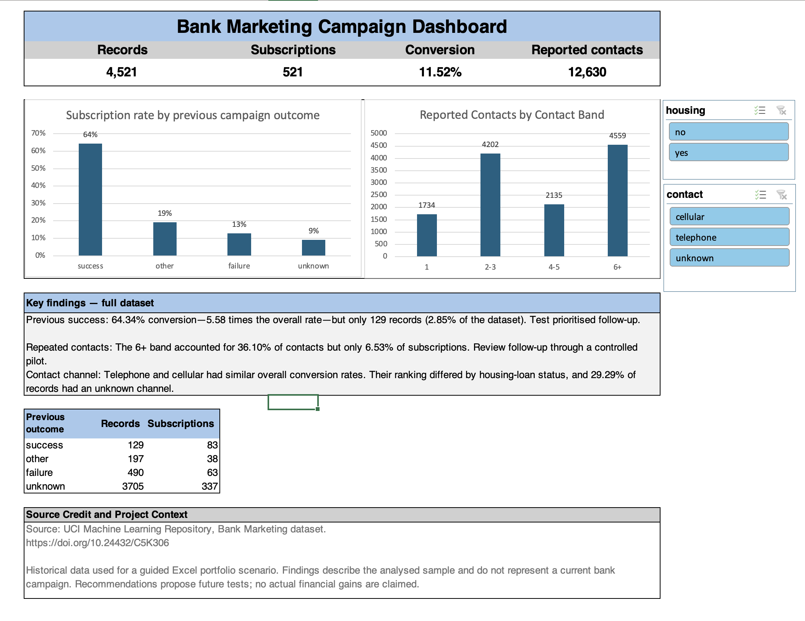

# Bank Marketing Campaign Analysis in Excel

A guided data-analysis portfolio project exploring which customers to prioritise, how to review repeated follow-up and what evidence is needed before choosing a contact channel.

The project uses historical UCI Bank Marketing data. It represents a portfolio scenario, not a current bank campaign. Recommendations propose future tests rather than claiming causal improvements or realised savings.

## Dashboard preview



[View the dashboard PDF](dashboard/Dashboard.pdf) · [Download the Excel workbook](workbook/Bank_Marketing_Portfolio.xlsx) · [Read the executive summary](reports/Executive_Summary.pdf) · [View the presentation](reports/Presentation.pdf)

To use the interactive filters, download the workbook and open it in Microsoft Excel. GitHub previews and PDFs do not run Excel slicers.

## Business questions

1. How does previous campaign outcome relate to current subscription?
2. How do conversion and contact activity differ by contact frequency?
3. How do cellular and telephone results compare, including within housing-loan groups?

## Data and tools

- **Source:** [UCI Bank Marketing dataset](https://doi.org/10.24432/C5K306), by S. Moro, P. Cortez and P. Rita.
- **Sample:** The older `bank.csv` sample with 4,521 records and 17 original columns, including the subscription outcome `y`.
- **Tools:** Microsoft Excel, structured table references, COUNTIFS, SUMIFS, GETPIVOTDATA, conditional formatting, seven PivotTables, charts and slicers.
- **Outcome:** Whether the customer subscribed to a term deposit.

## Baseline results

All figures below describe the full sample with filters cleared.

| Metric | Result | Definition |
|---|---:|---|
| Records | 4,521 | Number of data rows |
| Subscriptions | 521 | Records where `y = yes` |
| Conversion | 11.52% | Subscriptions divided by records |
| Reported contacts | 12,630 | Sum of `campaign`, including the last contact |
| Average contacts per record | 2.79 | Reported contacts divided by records |
| Contacts per subscription | 24.24 | All reported campaign contacts divided by subscriptions |

Contacts per subscription includes contact activity for both subscribers and non-subscribers. It is not the average contact count among subscribers alone.

## Analysis workflow

1. Preserve the original data and prepare a separate Excel Table named `BankClean`.
2. Audit record counts, outcomes, blanks, unknown categories, exact duplicates and unusual values.
3. Retain legitimate negative balances and the documented `pdays = -1` code for no previous contact.
4. Create helper columns for subscription flags, contact bands, age bands, prior contact, month order and duration in minutes.
5. Build PivotTables for overall KPIs, previous outcome, contact intensity, channel, job, month and housing/channel comparisons.
6. Connect the dashboard to contact and housing-loan slicers.
7. Reconcile totals, independently check a segment with formulas and test filter combinations.
8. Document recommendations, missing financial inputs and a controlled-pilot proposal.

## Key findings

### Previous success had a high conversion rate but a small audience

| Previous outcome | Records | Subscriptions | Conversion | Lift |
|---|---:|---:|---:|---:|
| Success | 129 | 83 | 64.34% | 5.58 |
| Other | 197 | 38 | 19.29% | 1.67 |
| Failure | 490 | 63 | 12.86% | 1.12 |
| Unknown | 3,705 | 337 | 9.10% | 0.79 |

Lift is the group conversion rate divided by overall conversion. Previous success had the strongest observed association with subscription, but represented only **2.85% of records**.

### Repeated-contact activity warrants review

| Contact band | Records | Subscriptions | Conversion | Contact share | Subscription share |
|---|---:|---:|---:|---:|---:|
| 1 | 1,734 | 240 | 13.84% | 13.73% | 46.07% |
| 2–3 | 1,822 | 195 | 10.70% | 33.27% | 37.43% |
| 4–5 | 492 | 52 | 10.57% | 16.90% | 9.98% |
| 6+ | 473 | 34 | 7.19% | 36.10% | 6.53% |

The 6+ band accounted for **36.10% of contacts** but only **6.53% of subscriptions**. This does not prove that additional contacts reduce conversion: harder-to-convert customers may receive more follow-up.

Contact share uses all reported contacts as its denominator. Subscription share uses all subscriptions. Record share uses all records. Rounded shares may not sum to exactly 100%.

### Channel comparisons depend on customer composition

| Housing-loan status | Cellular conversion | Telephone conversion |
|---|---:|---:|
| No | 17.22% | 20.81% |
| Yes | 11.56% | 6.25% |
| Overall | 14.36% | 14.62% |

Telephone had a slightly higher overall rate, but the higher-converting channel differed by housing-loan status. Channel was unknown for **1,324 records (29.29%)**. Unknown is a data-quality category, not a channel that a manager can select.

### Rate and volume answer different questions

Retired customers had the highest job-group conversion rate, **23.48%**, while management generated the most subscriptions, **131**. Student and unknown job groups contained fewer than 100 records and were flagged for review. The 100-record threshold is an analyst rule, not a statistical-significance test.

October had the highest observed monthly conversion rate, **46.25% from 80 records**. May generated the most subscriptions, **93 from 1,398 records**. These are pooled month comparisons without a year field, not evidence of a chronological or year-over-year trend.

## Recommendations and proposed tests

| Recommendation | Proposed owner | Next test |
|---|---|---|
| Prioritised follow-up for previous-success customers | Campaign manager | Randomly compare a defined follow-up approach with current practice |
| Review repeated-contact practices | Contact-centre manager | Compare a pause or lower-frequency approach with current practice among equally eligible customers |
| Improve channel recording | CRM/data-quality lead | Audit unknown records and pilot improved capture with one team |

The proposed follow-up pilot would measure conversion, additional contacts and complaints over a common period. A power calculation and agreed decision thresholds should precede sample-size selection. Eligibility and timing rules require business review.

## Validation

- Reconciled **521 yes + 4,000 no = 4,521 records**.
- Reconciled PivotTable totals with the source table.
- Independently checked housing = yes and contact = cellular using COUNTIFS and SUMIFS: **1,462 records, 169 subscriptions and 11.56% conversion**.
- Tested the following dashboard filter combinations against the supplied reference dashboard:

| Filters | Records | Subscriptions | Conversion | Reported contacts |
|---|---:|---:|---:|---:|
| All | 4,521 | 521 | 11.52% | 12,630 |
| Cellular | 2,896 | 416 | 14.36% | 7,966 |
| Housing = yes | 2,559 | 220 | 8.60% | 7,124 |
| Cellular and housing = yes | 1,462 | 169 | 11.56% | 3,861 |

The guided project includes a reference answer key used for baseline cross-checking. The portfolio documents the analysis steps and independent formula checks as well as the results.

## Limitations

- Historical observational results do not establish causation or guarantee future performance.
- Small groups and differences in customer composition affect interpretation.
- Unknown categories remain separate from true blanks.
- Contact duration is known after a contact and should not be used as a prospective targeting input.
- Pooled months do not support chronological or year-over-year claims.
- Contact costs, deposit values, net margin, retention and implementation costs are unavailable. No actual revenue, profit or savings are claimed.
- Written dashboard findings describe the full sample and do not change with slicers.

## Repository files

```text
bank-marketing-excel-analysis/
├── README.md
├── workbook/
│   └── Bank_Marketing_Portfolio.xlsx
├── dashboard/
│   ├── Dashboard.png
│   └── Dashboard.pdf
└── reports/
    ├── Executive_Summary.pdf
    ├── Presentation.pdf
    └── Presentation.pptx
```

## Source credit

Moro, S., Cortez, P., and Rita, P. (2012). *Bank Marketing*. UCI Machine Learning Repository. https://doi.org/10.24432/C5K306

This repository presents a guided Excel portfolio analysis of the historical dataset. Dataset ownership and attribution remain with the original source.
